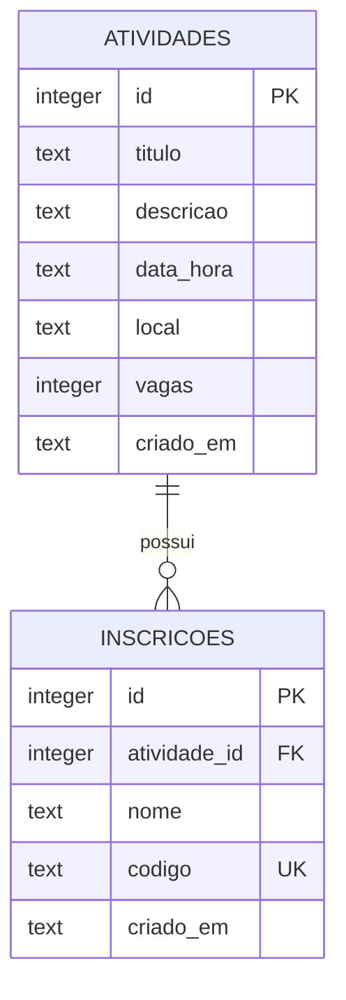
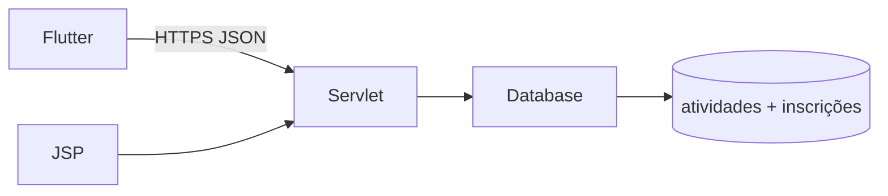

# Documento 3 — Modelagem e Estrutura Técnica

## Modelo de dados

O script executável de criação está em [`web/src/main/resources/schema.sql`](../web/src/main/resources/schema.sql). `atividade_id` referencia `atividades.id` com exclusão em cascata. `vagas` aceita 1 a 500; nome e campos descritivos têm limites. Índice em `atividade_id` acelera a contagem e o vínculo. `PRAGMA foreign_keys=ON` é aplicado em cada conexão JDBC.

## Operações SQL

`Database` usa `INSERT`, `SELECT`, `UPDATE` e `DELETE` parametrizados, com `JOIN` e `GROUP BY` para listar atividades e contagem de inscrições. A criação de inscrição verifica as vagas sob bloqueio sincronizado no processo único do Tomcat. Não se deve executar uma segunda instância da aplicação contra o mesmo arquivo de banco sem substituir essa regra por transação atômica.

## Classes e componentes

| Componente | Responsabilidade |
| --- | --- |
| `Activity`, `Booking` | Objetos imutáveis do domínio. |
| `Database` | Conexões JDBC, criação das tabelas e operações SQL. |
| `VitaServlet` | Rotas, sessão administrativa, validação e API JSON. |
| `admin.jsp`, `login.jsp` | Páginas administrativas renderizadas no servidor. |
| `VitaApi` (Flutter) | Requisições HTTP e leitura das respostas JSON. |
| `HomePage`, `BookingPage` (Flutter) | Agenda, inscrição e administração por código. |

## Fluxo de integração

API: `GET /api/activities`; `POST /api/bookings`; `POST /api/bookings/lookup`; `POST /api/bookings/update`; `POST /api/bookings/delete`. Os métodos `POST` usam formulário URL encoded. O código de inscrição funciona como credencial da reserva; a API não lista inscrições publicamente.

## Fluxo Mobile

Agenda → atividade → informar nome/apelido → receber código → consultar código → alterar nome ou cancelar. O código pode ser copiado; não há conta nem armazenamento local permanente.
